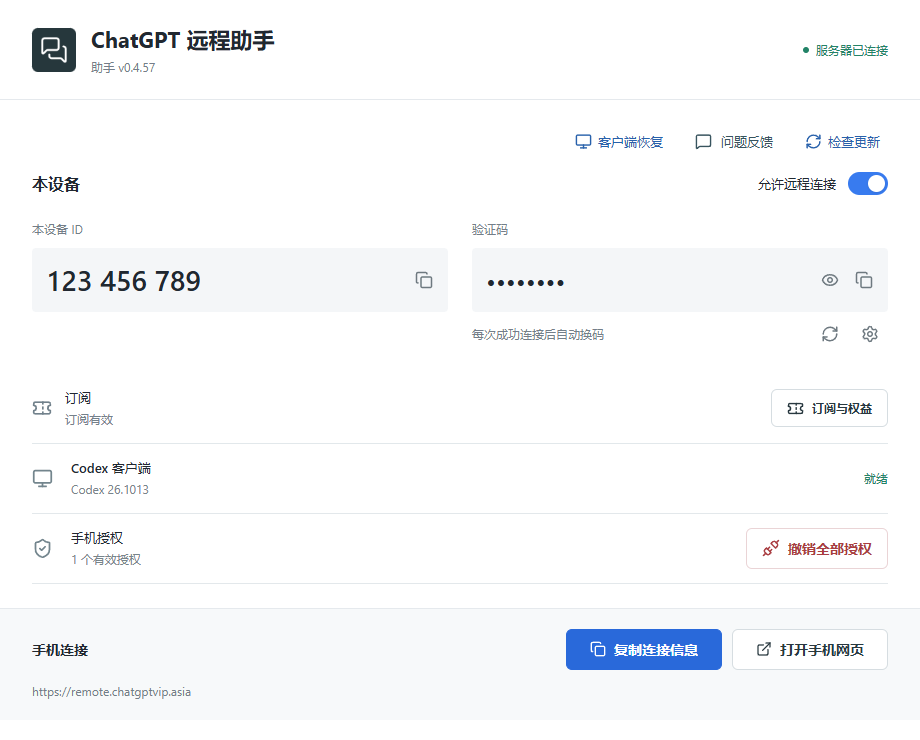
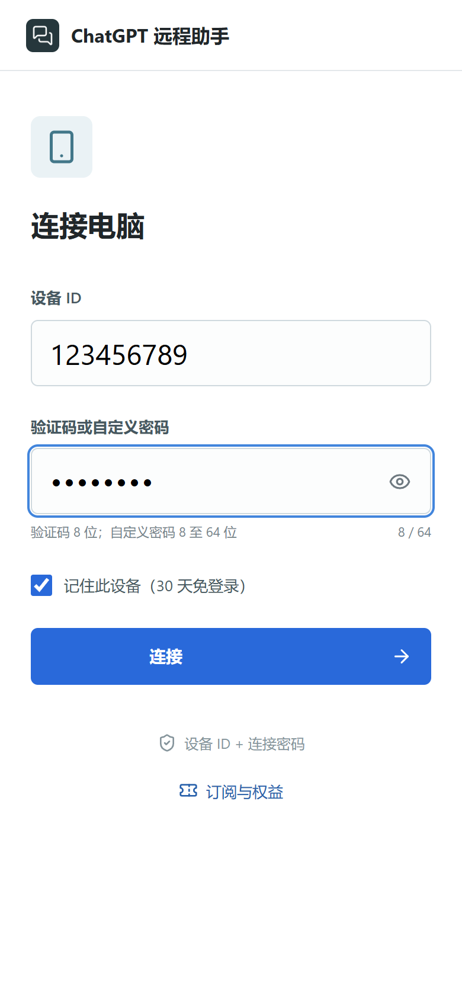
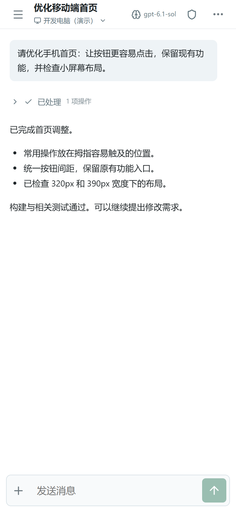
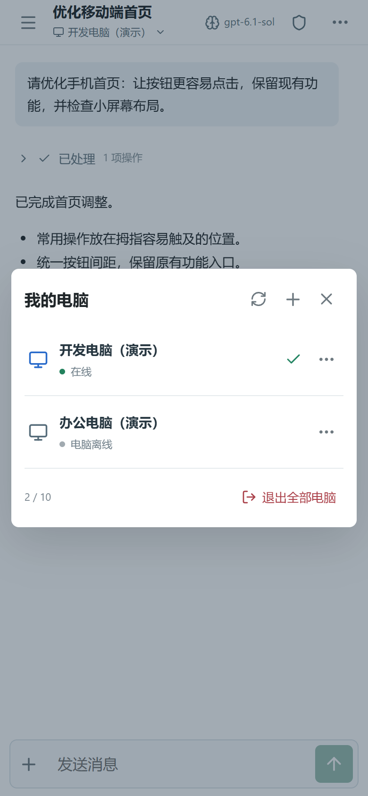
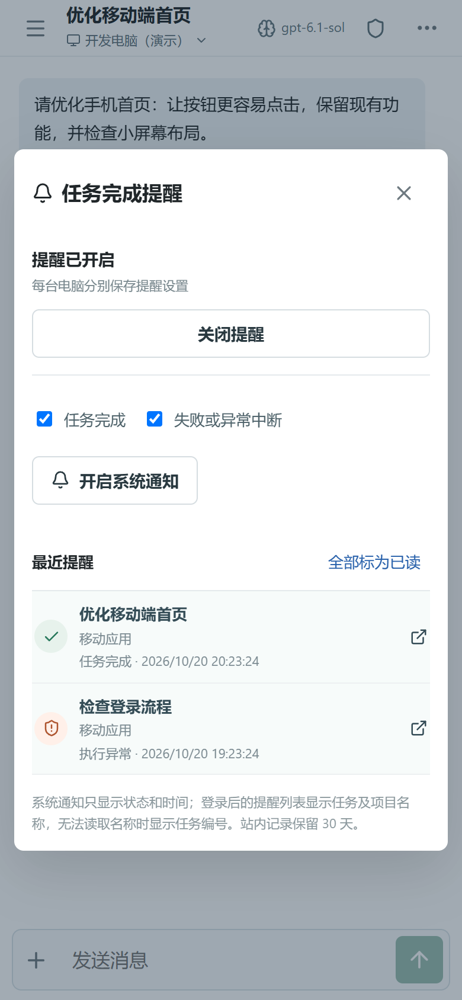

# Codex Mobile · ChatGPT Remote Assistant

**Keep your Codex work on your computer. Continue it from your phone.**

English | [简体中文](README.zh-CN.md)

[Download for Windows](https://github.com/jiabaochen79-collab/codex-mobile-client/releases/latest) · [Mobile website](https://remote.chatgptvip.asia/) · [Report a bug](https://github.com/jiabaochen79-collab/codex-mobile-client/issues)

Codex Mobile connects your phone to Codex desktop tasks running on your Windows computer. Check results, send follow-up work, answer questions and approvals, and switch computers without moving your workspace or files to a cloud computer.

> Independent, unofficial software. This project is not affiliated with or endorsed by OpenAI. It requires a working Codex desktop installation and your own account/model access. It does not include a ChatGPT subscription, model credits, or a cloud computer. The relay service is operated separately; its source is not included here.



Screenshots show the actual 0.4.57 interface with demonstration data. Device IDs, passwords, tasks, and subscription states are examples, not usable credentials or a promise of service eligibility. The current interface is in Chinese; instructions below include its button labels.

## What You Can Do

| Capability | Everyday use |
| --- | --- |
| Conversations and progress | Read tasks and results, expand command details when needed, and continue conversations from your phone. |
| Queue and steer | Submit follow-up work to the computer while it is busy, or adjust the running task's direction. |
| Plans and goals | Review plans before implementation, or give compatible Codex versions an objective and completion criteria. |
| Questions and permissions | Select an answer or type your own; change the current task's permission level. |
| Photos and files | Select photos, take pictures, upload files, and process supported HEIC photos. |
| Multiple computers | Pair computers separately, name them, and switch authorized devices. |
| Completion alerts | Use in-site notifications and supported Web Push to return to the corresponding task. |
| Updates and recovery | Download updates in the background and recover supported Codex crashes without automatically replaying uncertain work. |

## Download and Requirements

**Most users should download the `.exe` installer. You do not need Node.js or a source build.**

| Download | Use |
| --- | --- |
| [Latest release](https://github.com/jiabaochen79-collab/codex-mobile-client/releases/latest) | Recommended entry for the newest version and release notes. |
| [0.4.57 Windows installer](https://github.com/jiabaochen79-collab/codex-mobile-client/releases/download/v0.4.57/ChatGPT-Remote-Assistant-Setup-0.4.57.exe) | Install or upgrade the Windows assistant. |
| [0.4.57 portable ZIP](https://github.com/jiabaochen79-collab/codex-mobile-client/releases/download/v0.4.57/codex-mobile-windows-public.zip) | Alternative distribution with a bundled runtime; extract before use. |
| [Installer SHA-256](https://github.com/jiabaochen79-collab/codex-mobile-client/releases/download/v0.4.57/ChatGPT-Remote-Assistant-Setup-0.4.57.exe.sha256) · [ZIP SHA-256](https://github.com/jiabaochen79-collab/codex-mobile-client/releases/download/v0.4.57/codex-mobile-windows-public.zip.sha256) | Compare with the downloaded file. |

- **Computer:** Windows 10 build 19041 or newer, x64; supported Codex desktop; Internet access. Keep the computer awake and Codex and the assistant running.
- **Phone:** A current iPhone or Android browser. Basic remote access does not need a native phone app. Background notification requirements are below.
- **Network:** The devices do not need the same Wi-Fi. Both must reach the configured relay. The assistant connects outbound; normal use does not need router port forwarding.
- **Service access:** The operated relay may require a trial, authorization code, or subscription. Open client source does not include free service access. Check **订阅与权益** for live availability, prices, terms, and expiry.

Current installers are not Windows Authenticode signed and may trigger SmartScreen. Download from the release page, check the filename and checksum, and follow your organization's software policy. A matching checksum confirms file consistency; it does not replace code signing.

```powershell
Get-FileHash .\ChatGPT-Remote-Assistant-Setup-0.4.57.exe -Algorithm SHA256
```

GitHub is the current download source. A Gitee mirror is not yet available.

## Get Started

### 1. Prepare Your Computer

1. Open Codex desktop, sign in, and confirm that a task runs locally.
2. Install and launch **ChatGPT 远程助手** with the Windows installer.
3. Check **服务器已连接** (server connected), **Codex 客户端 → 就绪** (Codex ready), and enable **允许远程连接** (allow remote connections).
4. Click **复制连接信息** (copy connection information) and send it privately to your own phone. It contains the website address, nine-digit device ID, and connection password.

**打开手机网页** opens the website on the computer. Copying the connection information is usually more useful for pairing a phone. Do not post it in public screenshots, Issues, or group chats.

### 2. Connect Your Phone

1. Open the address copied from your assistant. The operated service uses [remote.chatgptvip.asia](https://remote.chatgptvip.asia/).
2. Enter **设备 ID** and the current **验证码或自定义密码**. IDs have nine digits; generated codes have eight characters; custom passwords have 8–64 characters. Use the eye icon to check your input.
3. On a personal device, optionally select **记住此设备（30 天免登录）**, then tap **连接**. Remembered authorization can still be revoked or expire earlier.
4. Open a task under **项目与会话**, or tap **+** to create one. If activation is required, open **订阅与权益** first.



In automatic-code mode, the code changes after a successful connection. Authorized phones retain their authorization; new phones need the current code. Use the Windows password settings icon to choose a fixed password. **撤销全部授权** disconnects existing phone authorizations.

### 3. Send Your First Task

Check the selected computer and conversation, enter a request, and tap the upward arrow. Read the result or return later. Work runs on the computer; sleeping the computer or exiting Codex interrupts that execution environment.



## Everyday Workflows

### Queue Messages and Adjust Direction

- While a task runs, enter the next request and use **排队发送**. **待发送** shows the computer assistant's queue.
- **Wait for “电脑已保存，排队中” before closing the browser.** A confirmed queue continues on the computer without the phone page. Drafts, unfinished uploads, and submissions with unknown results are not saved tasks.
- Open the send-options arrow and choose **调整方向** to steer the running task. Messages with attachments use the queue.
- **停止当前生成** stops the current generation; cancelling queued work and pausing a goal are separate operations.
- If a message shows **结果待核对**, inspect the conversation before retrying to avoid duplicate work.

See [queue and steering details](doc/queued-send-and-steering.md).

### Plans, Goals, Questions, and Permissions

| Control | How to use it |
| --- | --- |
| **+ → 计划模式** | Plan first, then review and confirm implementation. A plan chip appears in the composer. |
| **+ → 目标模式** | Enter an objective and completion criteria, then explicitly send. Compatible Codex manages native goal continuation. Selecting the mode starts no work. |
| Question card | Choose an option or type your own answer, then submit the card. |
| Shield beside the model | Open **任务权限** for the current task. The same entry appears under **…**. |
| **… → 在线终端** | Inspect terminals and explicitly take control if another terminal controls the computer. Viewing a task does not require taking control. |

Choose permissions appropriate to the work. **完全访问权限** grants broad computer access and requires confirmation; ordinary use does not require it. Availability depends on actual Codex and assistant compatibility.

More: [plan mode](doc/plan-mode.md) · [goal mode](doc/goal-mode.md).

### Photos and Files

Tap **+** beside the composer and choose **照片图库**, **拍照**, or **文件**. Inspect the preview and wait for upload success before sending. Supported HEIC photos use the photo-processing workflow; keep the original and report feedback if conversion fails.

Current service limits, also shown in **订阅与权益**, are five attachments per message, 25 MB per file, and 50 MB total. Browser support, available computer storage, and service limits also apply. Closing a browser does not finish an upload that is still in progress.

### Switch Computers

Tap the computer name below the task title, or **切换电脑** in the project list, to open **我的电脑**. Use **+** to pair another computer. Its **…** menu lets you rename, reorder, or remove its browser authorization.



Check the computer name before sending. Tasks, authorization, entitlement, and reminder settings are per computer. Pairing a second computer does not transfer the first computer's subscription.

### Enable Completion Reminders

Open **… → 任务完成提醒**. Enable reminders for the selected computer, choose completion and/or failure/interruption events, and allow system notifications when asked. If **开启系统通知** appears, use it to register this browser or Web App for background delivery.

| Phone or browser | Setup |
| --- | --- |
| iPhone/iPad, including Chrome | Use the current browser's **Share → More, if needed → Add to Home Screen**. Open that Web App from the home screen, reconnect if requested, and enable reminders there. No Safari transfer is needed. This client blocks background Push setup in ordinary iOS browser tabs. |
| Android Chrome | Enable reminders and grant notification permission directly. A home-screen app is optional. Battery restrictions, notification settings, force-stopping the browser, and network conditions can affect delivery. |
| Desktop Chrome/Edge | Browser Web Push works with permission. The Windows assistant itself does not display task notifications. |



Configure each computer separately. Tapping a reminder opens its task without sending, approving, or taking control. In-site records last 30 days. System notifications contain status and time, not task text; the authenticated list resolves task names. OS and push-service availability affect delivery; the in-site list remains available.

### Trial, Activation, and Support

- Open **订阅与权益** from Windows or the mobile project list for the selected computer.
- If a seven-day trial is available, read and accept the terms, then explicitly claim it. Installation alone does not start the trial; the service determines eligibility and expiry.
- Paste an authorization code into **授权码**, accept the terms, and choose **激活授权**. If online purchase is enabled, select an available plan and follow payment instructions. Check current prices and terms there.
- Expiry does not stop existing Codex work, but new remote operations may be restricted.
- Open **… → 问题反馈** on mobile or **问题反馈** on Windows. Include steps, time, and error codes; optionally add reviewed screenshots. Check **我的反馈** for replies, or open a sanitized [GitHub Issue](https://github.com/jiabaochen79-collab/codex-mobile-client/issues).

## Updates and Recovery

With automatic downloads enabled, updates download in the background. Once ready, confirm installation in the update dialog; **检查更新** also checks manually. Upgrades preserve device identity, passwords, remembered authorization, and user data. They replace the assistant and its connections without intentionally ending Codex or desktop tasks. Allow time to reconnect.

Old updaters may need one manual upgrade; install the current `.exe` over the existing installation. Recovery uses a local program backup instead of downloading an old installer. See [installation and power settings](doc/windows-installer-and-power.md).

If Codex is unavailable, inspect its reason before using **客户端恢复**. Recovery does not automatically resend interrupted tasks or uncertain messages. See [recovery behavior](doc/client-recovery.md).

## Troubleshooting

| Symptom | Check |
| --- | --- |
| Connection button disabled | Enter nine device-ID digits and an 8–64 character password. Use the current code, check spaces, and use the eye icon. |
| Computer offline | Keep the computer awake, assistant running, and remote access enabled. Both networks must reach the HTTPS service; company policies and VPNs may interfere. |
| Codex “未就绪” or compatibility warning | Open Codex, sign in, and verify a local task. Read the reason, update the assistant, and inspect **客户端恢复**. Version alone does not prove compatibility. |
| Can view but cannot send | Check viewer/controller status, another terminal's control lease, service expiry, and the displayed compatibility or permission reason. |
| No iPhone notification | Use the home-screen Web App, enable reminders for the correct computer there, and allow notifications in iOS settings. |
| Second computer has no notifications | Configure its reminders separately and verify its assistant is online and current. |
| Upload or send stalled | Wait for confirmation, retry after reconnection, and inspect **待发送**. Do not repeatedly submit work with an unknown previous result. |
| Older messages missing | Scroll upward and use history loading when shown; the visible page is not necessarily the entire conversation. |
| Windows installer warning | Verify the release and SHA-256; the package is unsigned. Do not disable certificate validation or system protection to resolve connectivity. |

## Privacy and Repository Boundary

- This repository contains the Windows helper, native companion, mobile web client, client tests, packaging scripts, and shared protocol snapshot.
- It excludes the relay server, administrator console, payments, deployment files, production data, credentials, certificates, and private keys. It is not a complete self-hosted server distribution.
- HTTPS protects transport with a valid certificate. **This is not end-to-end encryption:** the independently operated relay can process forwarded task content and notification metadata.
- Device IDs and connection passwords can authorize remote access. Revoke lost or untrusted authorizations.
- Feedback does not automatically include conversations, task files, or full logs. Review screenshots and diagnostics before submission. Never post passwords, cookies, TOTP seeds, model keys, private documents, or production logs in public Issues.
- Screenshots contain demonstration data only. Report vulnerabilities through [SECURITY.md](SECURITY.md).

## Build From Source

End users can use the installer. Contributors need Windows x64, Node.js 22.13 or newer, .NET Framework 4.8/native build tools, and Inno Setup to create installers.

```powershell
git clone git@github.com:jiabaochen79-collab/codex-mobile-client.git
cd codex-mobile-client
npm ci
npm run audit:public
npm run check
npm run native
npm run build
npm test

$env:RELAY_URL = 'https://remote.example.com'
npm run package:windows
npm run installer:windows
```

`RELAY_URL` must point to a compatible, separately operated service; the example is not a working server. Output includes `dist/agent.mjs`, mobile assets, and `dist/client-web-manifest.json`. The separate server can validate and import that web artifact. See [CONTRACTS.md](CONTRACTS.md) for shared protocol snapshots.

Read [CONTRIBUTING.md](CONTRIBUTING.md) before contributing. Original code uses [Apache-2.0](LICENSE); third-party terms and attribution are in [THIRD_PARTY_NOTICES.md](THIRD_PARTY_NOTICES.md) and [NOTICE](NOTICE).
